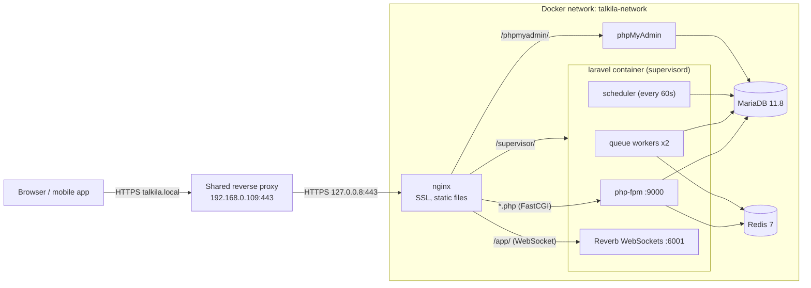
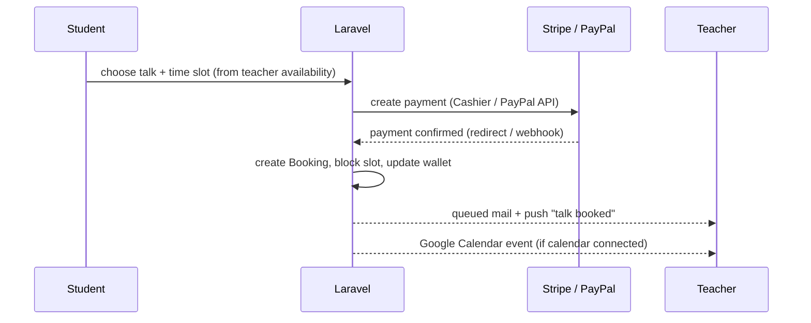
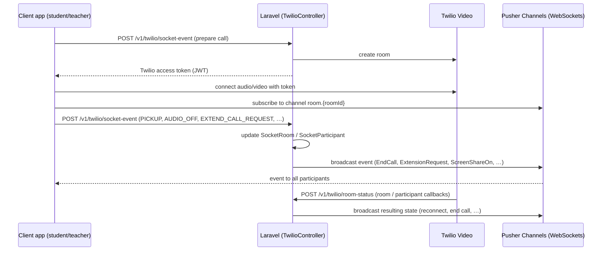

# Talkila

Talkila is a **booking-based e-learning marketplace**. Students find teachers and specialists, book a time slot, pay online, and meet them in a **1-on-1 (or group) video/audio call** directly in the browser or the mobile apps.

- **Booking & availability**: teachers publish talks and availability; students book slots. Teachers can connect their **Google Calendar** so availability and bookings stay in sync.
- **Payments**: **Stripe** (via Laravel Cashier) and **PayPal**, plus an internal **wallet/coins** system, refunds and teacher **payouts**. Adyen support exists in the code base.
- **Live calls**: **Twilio Video** provides the media (audio/video/screen share). Call state (ringing, pickup, hang-up, extend call, raise hand, kick, …) is coordinated by the Laravel backend through **socket events** and **Twilio room status callbacks**, and pushed to clients over **WebSockets** (Laravel Reverb).
- **Admin panel**: users, talks, categories, bookings, payouts, profile and image verification, reports, affiliates.

---

## Quick start

Requirements: Docker + Docker Compose.

```bash
cp .env.example .env                                   # Docker Compose variables
cp talkila.backend/.env.example talkila.backend/.env   # Laravel variables (fill in secrets)

docker compose up --build -d
docker compose exec -u www-data laravel php artisan key:generate
docker compose exec -u www-data laravel php artisan migrate --seed      # base data + admin user
docker compose exec -u www-data laravel php artisan passport:client --personal --name="Talkila Personal Access Client" --provider=users --no-interaction
```

Run `artisan` and `phpunit` as **`-u www-data`** (php-fpm's user). Files they create as root (logs, compiled views) make the site fail with HTTP 500.

The stack binds to the loopback IP **127.0.0.8**, so it can run next to other Docker projects without port clashes. It is exposed on the LAN through the shared reverse proxy (`~/Desktop/gambling/reverse-proxy`) as **https://talkila.local**.

Add this to the hosts file of the machine you browse from (Windows: `C:\Windows\System32\drivers\etc\hosts`):

```
192.168.0.109  talkila.local
```

| What | URL |
|---|---|
| Website | https://talkila.local |
| Admin login | https://talkila.local/login (redirects to `/adminIndex`) |
| phpMyAdmin | https://talkila.local/phpmyadmin/ (server `mariadb`, user/password from `.env`) |
| Supervisor UI | https://talkila.local/supervisor/ |
| MariaDB (from the host) | `127.0.0.8:3306` |

The seeded admin account is `admin@admin.com` / `password`. Change it on any shared machine.

---

## Repository layout

```
.
├── docker-compose.yml        # the whole local stack
├── .env.example              # Docker Compose variables (DB name/user/password)
├── package.json              # CI tooling (ESLint, Stylelint, Playwright) + the release version
├── .github/workflows/        # CI/CD (see DEPLOYMENT.md)
├── scripts/                  # build-release.sh, deploy.sh, ci/ helpers
├── deploy/                   # production .htaccess, pinned SSH host keys, production .env template
├── tests/e2e/                # Playwright tests
├── DEPLOYMENT.md        # how releases reach production
├── Docker/
│   ├── Nginx/                # nginx image, vhost (default.conf), self-signed SSL cert
│   ├── Laravel/              # PHP 8.5-FPM image, php.ini, supervisord.conf
│   └── MariaDB/              # init script: creates the talkila_test database for PHPUnit
└── talkila.backend/          # the Laravel 12 application (website, admin, REST API, call server)
```

---

## Docker architecture



| Service | Image | Role |
|---|---|---|
| `nginx` | `nginx:1.25-alpine` (custom) | Terminates SSL, serves `public/`, sends PHP to FPM, proxies `/app/` (WebSockets), `/phpmyadmin/`, `/supervisor/`. Binds `127.0.0.8:80/443`. |
| `laravel` | `php:8.5-fpm` (custom) | Runs the app. **Supervisord** manages php-fpm, 2 Redis queue workers, the scheduler loop and the Reverb WebSocket server. Workers run as `www-data`. |
| `mariadb` | `mariadb:11.8` | Main database, same engine and version as production. Data in the `talkila_mariadb-data` volume. Binds `127.0.0.8:3306`. Also holds `talkila_test` for PHPUnit. |
| `redis` | `redis:7-alpine` | Cache, sessions and queues. |
| `phpmyadmin` | `phpmyadmin:5.2` | Database UI under `/phpmyadmin/`. |

Notes:

- The source code is **bind-mounted** (`./talkila.backend → /var/www/html`), so code changes apply immediately. Restart the `laravel` container after changing `.env`, because the queue workers keep the old config in memory.
- The compose project is pinned with `name: talkila`, so the named volumes keep the same names even if the folder is renamed.
- Live call events go through **Pusher Channels** (cluster `eu`), locally and in production. The Reverb server in the container (`autostart=false`) is only a fallback: to use it instead, set `PUSHER_HOST=laravel`, `PUSHER_PORT=6001`, `PUSHER_SCHEME=http` and start it from the Supervisor UI.
- `talkila.backend/storage` must be owned by `www-data`. If you get "Permission denied" on log files, run:
  `docker compose exec laravel chown -R www-data:www-data storage bootstrap/cache`

### Useful commands

```bash
docker compose exec laravel php artisan <command>   # artisan
docker compose exec laravel composer <command>      # composer
docker compose exec laravel npm run build           # frontend assets
docker compose exec laravel vendor/bin/phpunit      # tests
docker compose exec laravel php artisan optimize:clear
docker compose logs -f laravel                      # app + supervisor logs
```

---

## Application architecture (Laravel)

**Stack:** Laravel 12, PHP 8.5, MariaDB 11.8, Redis 7, Laravel Passport (API tokens), Laravel Cashier (Stripe), Pusher Channels (WebSockets; Laravel Reverb as self-hosted fallback, Pusher protocol), Twilio SDK, Spatie Media Library, Spatie Webhook Client.

### Layers

```
HTTP request
  → routes/*.php            (grouped by audience, see below)
  → Middleware              (auth, role, verification, timezone, locale, CSRF)
  → Controllers             (Admin, Frontend, Api\V1, TwilioController, Socket*Controller)
  → Models / app/Entity     (Eloquent models, typed constants, service wrappers)
  → Events → Jobs → Mail    (async side effects through Redis queues)
```

| Folder | Contents |
|---|---|
| `routes/` | `public.php`, `web.php` (site), `auth.php` (login, register, OAuth), `private.php` (logged-in students/teachers), `admin.php` (role `Admin`), `affiliates.php` (role `Affiliate`), `api.php` (REST API v1 + Twilio), `frontend-api.php` (AJAX), `channels.php` (WebSocket channels) |
| `app/Http/Controllers/` | `Admin\*` (admin panel), `Frontend\*` (website), `Api\V1\*` (mobile/SPA API), `PayPal\*`, `TwilioController`, `Socket*Controller` |
| `app/Http/Middleware/` | Role gates (`AdminUser`, `TeacherStudentUser`, `AffiliateUser`, `ValidateRole`), `VerificationMiddleware`, `UpdateTimezone`, `SetLocale`, … |
| `app/Models/` | ~75 Eloquent models: `User`, `Talk`, `Booking`, `Availability`, `Calendar`, `CalendarAccount`, `Wallet`, `WalletHistory`, `Payout`, `Feedback`, `SocketRoom`, `SocketParticipant`, … |
| `app/Entity/` | Constants and service wrappers: `Events` (call event codes), `CallTypes`, `RoomStates`, `ParticipantStates`, `Twilio` (rooms, tokens, kick, SMS), `Notification` (Firebase + APNS push) |
| `app/Events/` | Broadcast events sent to call participants (`EndCall`, `ReconnectToRoom`, `ScreenShareOn/Off`, `ClientRaiseHand`, `ExtensionRequest`, `OneMinuteLeft`, …) |
| `app/Jobs/` | Queued notifications (talk booked/cancelled/postponed, starts in 10/1 minute, missed call, refunds, payouts, verification results) and webhook processing (`ProcessAdyenWebHook`, `ProcessWebsocketWebHook`) |
| `app/Mail/` | Mailable classes used by the jobs |
| `app/Console/Commands/` | Scheduled tasks (see below) |

### Users and roles

- **Student**: browses talks, books and pays, joins calls, leaves feedback.
- **Teacher**: publishes talks and availability, connects Google Calendar, takes calls, receives payouts. Must pass **profile verification** (an admin reviews the verification photo).
- **Affiliate**: has their own dashboard and revenue tracking.
- **Admin**: full back office at `/adminIndex`.

### Booking and payment flow



- **Stripe** goes through Laravel Cashier. Locally, forward webhooks with the Stripe CLI:
  `stripe listen --forward-to https://talkila.local/stripe/webhook --skip-verify`
- **PayPal** uses the REST API (`app/Http/Controllers/PayPal`, sandbox by default).
- **Wallet / coins**: balance and history (`Wallet`, `WalletHistory`) used for refunds and payments.
- **Refunds**: soft and hard refunds, automatic refund when the teacher does not show up (`RefundIfSupplierDidNotShow`).
- **Payouts**: teachers are paid out by the `PayoutProcess` command.

### Google Calendar integration

Teachers connect their Google account via OAuth (`/auth/google/calendar`). On connect, Talkila creates its own calendar in the teacher's Google account. Connected accounts are stored as `CalendarAccount` with their `Calendar`s (`app/Http/Controllers/Api/V1/Admin/CalendarController.php`, `app/Services/Calendar.php`).

- `calendar:fetch` (every minute) imports Google events, stored as `Event`, for accounts that are not synchronized yet.
- `calendar:sync` (daily) keeps them synchronized.

If a calendar gets disconnected, the user is notified by e-mail (`CalendarDisconnected`).

### Live calls: Twilio + socket events

Twilio carries the **media**. Laravel is the **signalling and state authority**: it decides who may join, tracks room and participant state, and tells every client what happens through WebSocket broadcasts.



Two event streams meet in the backend:

1. **Socket events from the clients**: `POST /v1/twilio/socket-event`, handled by `TwilioController@handleEvents`. Each event has a numeric code from `app/Entity/Events.php`, for example:
   `PICKUP (10)`, `HANGUP (11)`, `REDIAL (12)`, `CLIENT_WAITING (13)`, `TALK_END (15)`, `AUDIO_ON/OFF (21/20)`, `VIDEO_ON/OFF (31/32)`, `EXTEND_CALL_REQUEST (57)`, `EXTEND_CALL_ACCEPT/REJECT (55/56)`, plus raise hand, screen share and kick.
2. **Twilio events**: room and participant status callbacks on `POST /v1/twilio/room-status` (`TwilioController@roomStatus`), plus `POST /v1/twilio/network-quality` for call quality metrics.

Both streams update `SocketRoom` / `SocketParticipant` (and `SocketRoomError` on failures). The backend then broadcasts a Laravel event on the private channel **`room.{roomId}`** through Pusher Channels. All Twilio routes require an API token (`auth:api`, Laravel Passport).

Time-driven call logic runs in the scheduler:

| Command | When | Purpose |
|---|---|---|
| `check_talk_start_time_ten_minutes` | every minute | "talk starts in 10 minutes" notifications |
| `check_talk_start_time_one_minute` | every minute | "talk starts in 1 minute" notifications |
| `start:newroom` | every minute | opens Twilio rooms for talks that are starting |
| `notify:duration` | every minute | call duration warnings (e.g. `OneMinuteLeft`) |
| `calendar:fetch` | every minute | Google Calendar import |
| `remove:not_verified_users` | every 30 minutes | clean up unverified sign-ups |
| `calendar:sync`, `update:users_inactive`, `static:metric` | daily | calendar sync, inactive users, statistics |

Call timing settings (ringing time, pickup window, group size) live in `talkila.backend/.env` (`RINGING_TIME_FOR_CALL`, `PICKUP_TIME_FOR_CALL_*`, `GROUP_PARTICIPANTS_LIMIT`).

### Notifications

The usual pattern is **Event → queued Job → Mail and/or push**:

- **E-mail**: Laravel Mail (Mailtrap locally).
- **Push**: Firebase for Android, APNS VoIP pushes for iOS incoming calls (`app/Entity/Notification.php`).
- **In-call**: WebSocket broadcasts on `room.{roomId}`.

### Other integrations

- **Social login**: Google, Facebook, Apple, LinkedIn, Instagram, Twitter (Socialite). Redirect URLs must be registered with each provider for `https://talkila.local`.
- **Media**: Spatie Media Library and `public/assets/images/user/{id}/` for profile and verification photos.
- **Image moderation**: Google Cloud Vision SafeSearch. The service account key goes in `talkila.backend/storage/app/google/` and is never committed.

---

## Configuration

| File | Purpose | In git |
|---|---|---|
| `.env` | Docker Compose: DB credentials | no (`.env.example` is) |
| `talkila.backend/.env` | Laravel: app URLs, DB/Redis, mail, Stripe, PayPal, Twilio, OAuth, push, call timing | no (`.env.example` is) |
| `talkila.backend/.env.docker` | Alternative Laravel env for Docker | no (`.env.docker.example` is) |

Important Laravel variables:

- `APP_URL`, `APP_FRONTEND_URL`, `APP_BACKEND_URL`: must use the host you browse with (`https://talkila.local`). E-mail links (account activation, …) are built from `APP_FRONTEND_URL`.
- `SESSION_DOMAIN=talkila.local`
- `DB_*`, `REDIS_HOST=redis`
- `STRIPE_KEY`, `STRIPE_SECRET`, `STRIPE_WEBHOOK_SECRET`, `PAYPAL_*`
- `TWILIO_ACCOUNT_SID`, `TWILIO_AUTH_TOKEN`, `TWILIO_API_SID`, `TWILIO_API_SECRET`
- `PUSHER_*`: the Pusher Channels app (`PUSHER_APP_CLUSTER=eu`). Keep `PUSHER_HOST`, `PUSHER_PORT` and `PUSHER_SCHEME` empty to use Pusher; CI uses `BROADCAST_DRIVER=log`.
- `FIREBASE_ACCESS_KEY`, `APNS_*`: push notifications

Never commit real `.env` files or credentials. GitHub push protection rejects them.

---

## Testing

```bash
docker compose exec -u www-data laravel vendor/bin/phpunit --testsuite Api,Web   # PHPUnit (uses the talkila_test database)
npm ci && npx playwright install chromium                                       # once
npx playwright test                                                             # E2E against the running stack
npm run lint                                                                    # ESLint + Stylelint on talkila.backend/public
```

- **PHPUnit** (`talkila.backend/tests/Feature/Api`, `tests/Feature/Web`) runs against the separate `talkila_test` database. `tests/TestCase.php` refuses to run against any database not named `*_test`, because `RefreshDatabase` drops every table.
- **Playwright** (`tests/e2e`) opens `https://talkila.local` in Chromium (desktop + mobile) and maps the name straight to the stack's `127.0.0.8`, so no hosts entry is needed.
- **Lint** covers our own JS/CSS in `public/` (vendored libraries and compiled bundles are skipped). It is **report-only** in CI for now.

---

## CI/CD and deployment

Workflow file: `.github/workflows/ci-cd.yml`. Full guide (first deployment, migrations, seeders, maintenance mode, backups, rollback, troubleshooting): **[DEPLOYMENT.md](DEPLOYMENT.md)**.

**Tests run on every change. The site is deployed only when you push a release tag.**

| Event | Name in the Actions list | Tests | Deploys |
|---|---|---|---|
| **Pull request into `master`** | `🔎 PR #12: <PR title>` | ✅ | ❌ |
| **PR merged into `master`**, or **direct push to `master`** | `✅ master: <commit message>` | ✅ | ❌ |
| **Release tag pushed**: `vX.Y.Z` | `🚀 Release v1.2.0` | ✅ | ✅ only if every test **and** the release check pass |
| **Manual** (Actions → CI/CD → Run workflow) on a branch / on a tag | `🔁 Manual checks …` / `🚀 Release v1.2.0` | ✅ | ❌ / ✅ redeploys that release |

```
🔍 Lint (report-only) ─────────────────────────────────────────────┐
🐳 Build Docker image ──┬──→ 🧪 PHPUnit — API ─────┐               │
                        ├──→ 🌐 PHPUnit — web ─────┼──→ 📦 Release ─┼──→ 🚀 Deploy to talkila.blazingsun.space
                        └──→ 🎭 E2E (Playwright) ──┘     bundle    │      (tags only, everything green)
🏷️ Release check (tags only) ──────────────────────────────────────┘
```

The deploy turns the maintenance page on, rsyncs **only the changed files** over SSH, runs the migrations, turns maintenance off and smoke-tests the live site. If any step fails, the site stays in maintenance instead of running half-updated code.

### Releasing (deploying to the live site)

A release tag is `v` + the `"version"` in the root `package.json`, always three numbers: `vMAJOR.MINOR.PATCH`, for example `v1.2.0`. The **🏷️ Release check** job rejects a tag (and nothing is deployed) if:

| Rule | Example of a rejected tag |
|---|---|
| The tag must look like `vX.Y.Z` | `v1.0`, `v.1.0`, `1.0.0`, `v1.0.0-beta` |
| It must equal the `package.json` version at that commit, so the version was bumped | `v1.1.0` while `package.json` still says `1.0.0` |
| It must be higher than every earlier release | `v1.0.4` after `v1.0.5` exists |
| Its commit must already be on `master` | a tag on a feature branch |

**Recommended: one command bumps and tags.** Start on an up-to-date `master` with all your changes merged:

```bash
git checkout master && git pull

npm version patch          # 1.0.0 → 1.0.1  bug fixes
npm version minor          # 1.0.1 → 1.1.0  new features
npm version major          # 1.1.0 → 2.0.0  big/breaking changes
# npm version edits package.json, commits "1.1.0" and creates the tag v1.1.0

git push origin master --follow-tags     # pushes the bump commit AND the tag
```

This starts two runs: `✅ master: 1.1.0` (tests only) and `🚀 Release v1.1.0` (tests, release check, deploy).

**Manual alternative.** Same result, step by step:

```bash
git checkout master && git pull
# 1. Bump "version" in package.json (e.g. "1.0.0" → "1.1.0"), then:
git commit -am "Release 1.1.0"
git push origin master
# 2. Tag that commit and push the tag:
git tag -a v1.1.0 -m "v1.1.0: <what changed>"
git push origin v1.1.0
```

**First release:** `package.json` started at `1.0.0`, so the first release tag was `v1.0.0` (**already released**):

```bash
git checkout master && git pull
git tag -a v1.0.0 -m "v1.0.0: first release"
git push origin v1.0.0
```

**If a release is rejected or fails:** fix the problem, then release a **new** version (`npm version patch` and push again). To retry the same tag after a temporary failure (e.g. SSH timeout), use **Re-run failed jobs** on that run.

### Redeploy a release

**Actions → CI/CD → Run workflow → Use workflow from: Tags → `v1.1.0`**, or with the GitHub CLI:

```bash
gh workflow run ci-cd.yml --ref v1.1.0
```

Only the **latest** release can be redeployed. To go back to older code, revert it on `master` and release a new version; this prevents accidental rollbacks.

### Useful tag commands

```bash
git tag                                # list local tags
git ls-remote --tags origin            # list tags on GitHub
git show v1.0.0                        # see what a tag points to
git tag -d v1.0.0                      # delete a local tag
git push origin --delete v1.0.0        # delete a tag on GitHub
git checkout v1.0.0                    # look at a release's code (read-only; go back with: git checkout master)
```

---

## Known issues

- A few files do not follow PSR-4 naming (`app/Virtual/Resources/*Rersource.php`, `app/Http/TokenController.php`).

---

## License

Licensed under the [PolyForm Noncommercial License 1.0.0](LICENSE).

You may use, study, modify and share this project for **noncommercial purposes only**: personal use, research, education and non-profit organizations. **Commercial use is not permitted** without a separate written license from the copyright holder.

Copyright 2026 Milorad Đuković
